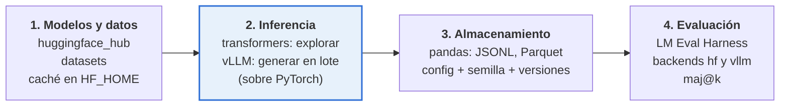

# Demo: Herramientas para experimentar con LLMs en un servidor de alta capacidad

17 de noviembre de 2026 · Dante

## Objetivo y alcance

Una demo introductoria de unos 20 minutos para que el curso se familiarice con las librerías principales para correr, guardar y evaluar experimentos con LLMs en un servidor con GPU. Está pensada para cualquier servidor y cualquier paper: el código detecta el hardware disponible y no asume un modelo de GPU.

El paper *Optimal Self-Consistency for Efficient Reasoning with Large Language Models* (arXiv 2511.12309) aporta solo el escenario. Los autores generan 100 respuestas por pregunta (GSM8K, MATH, MMLU, GPQA-Diamond; temperaturas 0.4 a 1.0) y luego simulan distintos presupuestos de Self-Consistency a partir de esas muestras guardadas. Las herramientas que citan son **PyTorch, vLLM y LM Eval Harness**. La demo usa esas mismas herramientas más **transformers**, a escala de juguete: 10 a 20 preguntas de GSM8K y 5 muestras por pregunta.

Queda fuera del alcance: el simulador de Self-Consistency, Blend-ASC y los otros algoritmos del paper, las leyes de escalado y la replicación de sus tablas. Lo único que se toma del paper es su patrón de trabajo: **generar una vez, guardar todo y analizar muchas veces** (en la demo, un voto de mayoría sobre las muestras guardadas).

### Entorno de desarrollo y modelo

- **Máquina local:** RTX 2060 (6 GB, arquitectura Turing) con Windows. vLLM no corre en Windows, así que todo se ejecuta dentro de **WSL2 (Ubuntu)**, lo que además se parece al servidor Linux.
- **Modelo:** `Qwen/Qwen2.5-1.5B-Instruct` (~3 GB en float16, sin acceso restringido, misma familia que los modelos Qwen del paper). Si falta memoria, `Qwen/Qwen2.5-0.5B-Instruct`. En el servidor se cambia solo el nombre del modelo en `config.yaml` (por ejemplo, a `meta-llama/Llama-3.2-3B-Instruct`, que requiere aceptar la licencia).
- **Precisión:** Turing no soporta bfloat16, así que se usa float16. El código elige el `dtype` según la GPU detectada.
- **Memoria en vLLM:** limitar `max_model_len` (~2048) y `gpu_memory_utilization` (~0.85) para que quepan el modelo y su caché de atención (KV cache).

## Parte 1: Estructura de la demo (~20 min)

Son 8 bloques. Cada uno presenta una herramienta, explica para qué sirve y la muestra funcionando sobre el mismo ejemplo: 10 preguntas de GSM8K y un modelo pequeño.



*Cada etapa tiene su herramienta; en inferencia se elige entre dos motores.* Los bloques 3 a 7 recorren estas cuatro etapas en orden; la inferencia ocupa dos bloques porque se comparan ambos motores.

1. **Mapa de herramientas (1 min)**
   - Mensaje: cada etapa de un experimento con LLMs tiene su herramienta, y en la inferencia hay varias opciones con distintos compromisos.
   - Mostrar: el diagrama de arriba y el escenario del paper (100 respuestas por pregunta, guardadas y luego analizadas con distintos presupuestos).
2. **Reconocer el servidor (2 min)**
   - Mensaje: antes de correr nada, conviene saber qué hay y no pisar el trabajo de otros.
   - Herramientas: `nvidia-smi` o `nvitop` para ver GPUs y uso; PyTorch (`torch.cuda.device_count()`, `get_device_capability()`) para detectar GPUs y elegir el `dtype`; `CUDA_VISIBLE_DEVICES` para elegir GPUs; tmux para que el proceso sobreviva al cerrar la sesión; uv para el entorno con versiones fijadas.
3. **Modelos y datos desde Hugging Face (2 min)**
   - Mensaje: el Hub es la fuente común de modelos y datasets, y su caché evita descargar dos veces.
   - Herramientas: `huggingface_hub` (login, `snapshot_download`, variable `HF_HOME`) y `datasets` (`load_dataset("openai/gsm8k", "main")`).
   - Nota: los modelos Llama tienen acceso restringido y requieren aceptar la licencia; por eso la demo usa Qwen2.5-Instruct.
4. **Inferencia con transformers (3 min)**
   - Mensaje: es la opción más flexible y la más cercana al modelo, ideal para explorar y depurar.
   - Herramientas: `pipeline("text-generation")` y `AutoModelForCausalLM.generate()` con el chat template del modelo.
   - Mostrar: responder las 10 preguntas con una respuesta cada una y medir tokens por segundo.
   - Mención: en el servidor, `device_map="auto"` (accelerate) reparte un modelo grande entre GPUs.
5. **Inferencia con vLLM (4 min)**
   - Mensaje: para generar mucho, un motor de inferencia agrupa peticiones y aprovecha mejor la GPU.
   - Herramientas: `LLM` y `SamplingParams(n=5, temperature=0.8, seed=...)` para generación en lote.
   - Mostrar: las mismas 10 preguntas con 5 respuestas cada una, y comparar tokens por segundo con el bloque anterior.
   - Mención: `tensor_parallel_size` si el modelo no cabe en una GPU; `vllm serve` levanta una API compatible con OpenAI.
6. **Guardar las salidas (3 min)**
   - Mensaje: guardar todas las generaciones crudas junto con lo necesario para repetir la corrida, porque el análisis se hace después y sin volver a llamar al modelo.
   - Herramientas: pandas para escribir JSONL o Parquet, con una fila por muestra; un archivo con la config, la semilla, el prompt, la revisión del modelo y las versiones de las librerías.
   - Mostrar: releer el archivo y calcular accuracy y maj@k para k = 1…5 sin regenerar nada.
7. **Evaluar con LM Eval Harness (4 min)**
   - Mensaje: una herramienta estándar fija prompts, extracción de respuestas y métricas, para que los números sean comparables entre papers.
   - Herramientas: `lm_eval` con `--model hf` y `--model vllm`, `--tasks gsm8k`, `--limit 20`, `--output_path` y `--log_samples`; `--apply_chat_template` para modelos Instruct. Para Self-Consistency, una copia de la tarea `gsm8k_cot_self_consistency` con menos repeticiones, escrita como YAML propio.
   - Mostrar: la misma evaluación con los dos backends, el archivo de muestras que deja el harness y la métrica maj@k de la tarea propia.
8. **Cierre: cuándo usar qué (1 min)**
   - Mostrar: la tabla del mapa de herramientas.

Para que la demo no dependa de la red ni del tiempo de carga, el modelo y el dataset se descargan antes, y todo corre con 10 a 20 preguntas.

## Mapa de herramientas: cuándo usar cada una

La regla práctica: transformers para explorar, vLLM para generar en volumen, guardar todo lo generado y LM Eval Harness para reportar.

| Herramienta | Etapa | Para qué sirve | Cuándo conviene | Límite | En la demo |
| --- | --- | --- | --- | --- | --- |
| `nvidia-smi` / `nvitop`, tmux | Servidor | Ver GPUs y su uso; mantener procesos vivos | Siempre en un servidor compartido | Solo observan, no reservan recursos | Sí |
| uv | Servidor | Entorno con versiones fijadas | Siempre | Hay que fijar también la versión de CUDA de torch | Sí |
| PyTorch | Base | Tensores en GPU; base de transformers y vLLM | Detectar GPUs y elegir `dtype` | Rara vez se usa directo para generar | Sí |
| `huggingface_hub` | Modelos y datos | Login, descarga y caché de modelos | Siempre | Modelos restringidos requieren token y licencia | Sí |
| `datasets` | Modelos y datos | Cargar y transformar benchmarks | Cualquier dataset del Hub o local | Columnas y splits cambian entre datasets | Sí |
| `transformers` | Inferencia | Cargar y ejecutar modelos con acceso a logits y capas | Explorar, depurar, pocas generaciones | Lento para generar en volumen | Sí |
| vLLM | Inferencia | Generación en lote y servidor con API tipo OpenAI | Miles de generaciones o varias muestras por pregunta | Menos acceso a internals del modelo; solo Linux | Sí |
| pandas (JSONL, Parquet) | Almacenamiento | Guardar generaciones y metadatos | Siempre | No versiona ni registra corridas | Sí |
| LM Eval Harness | Evaluación | Benchmarks estándar con prompts y métricas fijas | Reportar resultados comparables | Tareas propias requieren escribir un YAML | Sí |
| `accelerate` | Inferencia | Repartir un modelo entre GPUs y CPU (`device_map`) | El modelo no cabe en una GPU | Reparte memoria, no acelera la generación | Mención |
| `bitsandbytes` | Inferencia | Cuantizar a 8 o 4 bits | Poca VRAM disponible | Puede perder calidad | Opcional |
| SGLang, TGI | Inferencia | Alternativas a vLLM para servir modelos | Comparar motores o si el servidor ya usa uno | No se usan en la demo | Mención |
| Weights & Biases, MLflow | Seguimiento | Registrar configuración, métricas y archivos por corrida | Muchas corridas o trabajo en equipo | W&B requiere cuenta; MLflow hay que alojarlo | Opcional |

## Parte 2: Plan de desarrollo de código interactivo

Son 6 módulos cortos que cubren los bloques 2 a 7 de la demo, más uno opcional. Cada script funciona solo, lee `config.yaml` y cierra con una validación visible que sirve para mostrar en la presentación.

| # | Módulo | Qué construyes | Concepto que aprendes | Archivo | Validación |
| --- | --- | --- | --- | --- | --- |
| 0 | Entorno | Entorno en WSL2 con uv y versiones fijadas; detección de GPUs, VRAM y capacidad de cómputo con PyTorch | Entornos reproducibles, servidor compartido, elegir `dtype` según la GPU | `00_check_env.py` | Imprime GPUs, VRAM, `dtype` elegido y versiones, o avisa si no hay GPU |
| 1 | Hub y datos | Login, descarga del modelo a la caché, carga de GSM8K y prompts con chat template | Caché del Hub, chat templates, respuesta gold tras `####` | `01_hub_and_data.py` | 10 prompts con su respuesta gold |
| 2 | Inferencia con transformers | `pipeline` primero y luego `generate()` | Tokenización y parámetros de generación | `02_transformers_infer.py` | 10 respuestas y tokens por segundo |
| 3 | Inferencia con vLLM | `LLM` con `SamplingParams(n=5, seed=...)` y límites de memoria para 6 GB | Generación en lote y muestreo múltiple | `03_vllm_infer.py` | 50 respuestas y comparación de tokens por segundo con el módulo 2 |
| 4 | Guardar y analizar salidas | Extraer el número final, marcar aciertos, escribir JSONL o Parquet con una fila por muestra y un archivo con config, semilla, prompt, revisión del modelo y versiones | Datos crudos vs. derivados, metadatos, generar una vez y analizar muchas | `04_save_outputs.py` | Releer el archivo y calcular accuracy y maj@k (k = 1…5) sin regenerar |
| 5 | LM Eval Harness | `gsm8k` con `--model hf` y `--model vllm`, `--limit 20`, `--log_samples`; tarea propia en YAML basada en `gsm8k_cot_self_consistency` con 5 repeticiones | Evaluación estándar, backends, tareas propias | `05_lm_eval.sh`, `tasks/` | Dos archivos de resultados comparables y la métrica maj@k de la tarea propia |
| 6 (opcional) | Extras | Registro en W&B o MLflow; `vllm serve` + cliente `openai`; carga en 4 bits con bitsandbytes | Seguimiento de corridas, inferencia como servicio, cuantización | `06_extras.py` | Corrida visible en el panel, respuesta vía API o menor uso de VRAM |

En cada módulo te explico el objetivo, tú escribes un esqueleto con `TODO`, lo revisamos y recién entonces lo completamos y validamos.

## Estructura del repositorio y próximo paso

Un script por módulo, numerados en el orden de la demo, con salidas y configuración separadas del código.

```
llm-tools-demo/
├── config.yaml            # modelo, dtype, nº de preguntas, n, temperatura, semilla
├── pyproject.toml         # dependencias fijadas con uv
├── 00_check_env.py
├── 01_hub_and_data.py
├── 02_transformers_infer.py
├── 03_vllm_infer.py
├── 04_save_outputs.py
├── 05_lm_eval.sh
├── tasks/                 # YAML de la tarea propia de LM Eval Harness
├── outputs/               # JSONL / Parquet + config usada
└── README.md
```

Próximo paso: Módulo 0, entorno en WSL2 y reconocimiento de la GPU.
